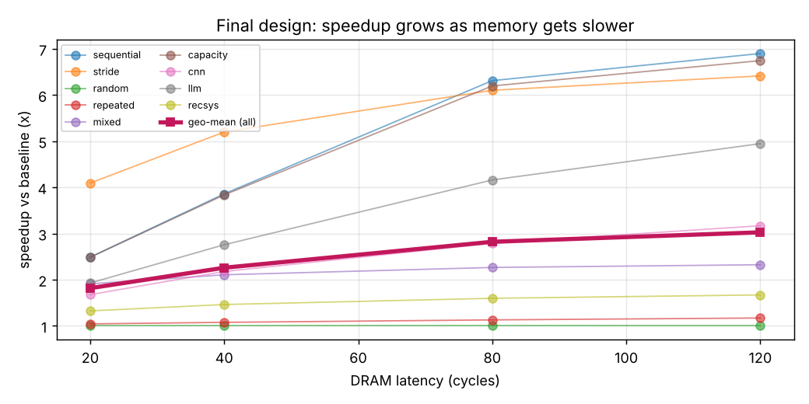

# AI-Aware Cache & Prefetch Engine — Final Technical Report

Micron RTL Challenge · Kotapati Kishore · 1 November 2026

## 1. Problem statement
AI workloads (LLMs, CNNs, recommenders) are fast at math but stall waiting for
data from DRAM. The task: build hardware that **watches** the addresses a
program reads, **guesses** the next ones, and **fetches them early** into the
cache, and prove it is faster than a cache without prefetching.

## 2. Objectives and what was delivered
| Level | Delivered |
|---|---|
| 1 Trace analysis | Python generator for 9 synthetic workloads (6 basic + CNN/LLM/recsys-inspired), analysis of locality/strides, plots |
| 2 Cache architecture | 4 KB, 4-way, 64 sets, 16 B lines, true LRU, 8 MSHRs, baseline cache |
| 3 Prefetch strategy | next-line, stride, adaptive stride, and a hybrid adaptive design (final) |
| 4 RTL | 7 synthesizable Verilog-2005 modules + DRAM model + self-checking testbench |
| 5 Validation | 54 RTL simulations (9 traces × 6 architectures), golden-model check, measured metrics |

## 3. System architecture
See `docs/architecture.md` (block diagram, FSM, arbitration rules, interfaces).

## 4. Cache architecture
4 KB, 4-way set associative, 64 sets, 16-byte lines, 32-bit addresses
(tag 31:10, index 9:4, word 3:2). True LRU with a per-line *prefetched* bit.
Blocking for the CPU (one outstanding load) but non-blocking for prefetches
(8 MSHRs). 1-cycle hit. DRAM model: 40-cycle latency, one new request every
4 cycles, in-order responses.

## 5. Prefetching algorithm
See `docs/algorithm.md`. Summary: a 4-entry address-region stride table with
2-bit confidence, byte-granular strides, page-bounded candidate generation,
duplicate filtering, plus three adaptive mechanisms: accuracy-feedback degree
(1…7), accuracy-gated next-line kick-off for new streams, and accuracy-adaptive
insertion position.

## 6. RTL modules
| File | Role | Synthesizable |
|---|---|---|
| `rtl/cache_controller.v` | demand FSM, MSHRs, probe filter, arbitration, counters | yes |
| `rtl/tag_array.v` | tags, valid and prefetched bits, 3 read ports | yes |
| `rtl/cache_memory.v` | data array | yes |
| `rtl/replacement_policy.v` | true LRU + LRU/MRU insertion | yes |
| `rtl/stride_predictor.v` | stream table, confidence, triggers, adaptive degree, accuracy flag | yes |
| `rtl/prefetch_engine.v` | predictor + candidate generator + 8-entry queue | yes |
| `rtl/top_module.v` | integration, run-time configuration | yes |
| `rtl/memory_model.v` | behavioural DRAM | simulation model |
| `testbench/tb_system.v` | trace-driven CPU model + self-checks | testbench |

Verilator 5.020 `--lint-only -Wall` on the RTL: **0 warnings, 0 errors**
(`results/verilator_lint.txt`).

**Synthesis check (Yosys 0.33, generic gates, `synth/`):** the design
synthesizes cleanly (`check -assert` passes) to 99,471 logic cells and 40,791
flip-flops. The prefetch engine (predictor + queue) is only 4.9 % of the cells
and 1.8 % of the flip-flops; the rest is cache storage. Generic gates give no
area, timing or power numbers, and no placement was done.

## 7. Simulation methodology
* Icarus Verilog 12.0, `-g2005`. One compiled simulator; the architecture is
  chosen with plusargs, so A and B use **identical RTL, traces and DRAM timing**.
* CPU model: waits the trace's compute gap, issues a load, waits for data.
  Execution cycles = cycles from the first issue to the last response.
* AMAT (measured) = sum of every load's latency / number of loads.
  AMAT (formula, also in the CSV) = 1 + miss-rate × baseline miss penalty.
* Prefetch accuracy = useful / issued (timely hits). Because late prefetches
  still cut latency, accuracy including late is also reported.
  Coverage = (baseline misses − misses) / baseline misses.
  Prefetches are never counted as demand accesses.

**Self-checks run in every simulation** (any failure marks the run FAILED):
1. every word returned to the CPU equals the DRAM content function of its address;
2. hits + misses = accesses = trace length;
3. no line is present twice in any set;
4. prefetch accounting closes: issued = useful + late + evicted-unused + resident-unused;
5. all MSHRs drain (no lost responses).

**Golden model:** without prefetching, hit/miss outcome does not depend on
timing, so the RTL baseline is compared with an independent Python LRU model
(`python/ref_cache_model.py`). It matches **exactly on all 9 traces**.

## 8. Test scenarios
| Required scenario | Covered by |
|---|---|
| Sequential | `sequential` |
| Fixed stride | `stride` (48 B, not line aligned), CNN pointwise phase (256 B) |
| Random | `random` |
| Repeated | `repeated` (shuffled 1.5 KB set ×10) |
| Mixed | `mixed` (2 streams + 25 % random) |
| Cold cache | every run starts from reset (empty cache) |
| Capacity pressure | `capacity` (8 KB array ×3 on a 4 KB cache) |
| Prefetch usefulness / accuracy | counters on every run |
| Demand during ongoing prefetch | happens constantly: `late` merges (e.g. 16 in the demo trace) and demand hits/misses while 7 prefetch MSHRs are busy, all data-checked |

Result: **54 / 54 simulations passed all self-checks.**

**Second simulator (Verilator 5.020, `python/verilator_crosscheck.py`):** the
same testbench and RTL compiled with `verilator --binary --timing` give
results **identical to Icarus in all 54 runs** — every counter, every cycle
count and every self-check (`results/verilator_crosscheck.txt`). Two
independent simulators agreeing means the results do not depend on one
simulator's event ordering.

**Cocotb tests (Cocotb 2.1 on Icarus, `testbench/cocotb/test_cache.py`) — 7/7 PASS:**

| Test | What it proves | Measured |
|---|---|---|
| hit_and_miss_latency | cold miss pays DRAM latency, rest of line hits in 1 cycle | miss 42 cyc, hit 1 cyc |
| lru_replacement | 5 lines in one 4-way set: the LRU line is the one evicted | pass |
| random_vs_golden_model | 1500 constrained-random loads, hits/misses equal Python model | 554 / 946, exact match |
| prefetch_removes_misses | 128-line stream: demand DRAM requests 128 → 1 | 22 misses (21 late merges), 1 demand request |
| demand_during_prefetch | load to an in-flight prefetched line merges (no 2nd DRAM request); unrelated miss not delayed while 3 prefetches are in flight | merge waited 11 cyc; miss 42 cyc |
| no_prefetch_across_page | stream ending at a 4 KB boundary never prefetches into the next page | 30 issued, 0 across |
| random_traffic_is_throttled | 600 random loads → accuracy gate limits waste | 32 prefetches |

Two of these tests failed on their first run because the test itself was wrong
(a too-strict miss limit that counted late merges as full misses, and a merge
test that loaded a line which had already arrived). The tests were corrected
to check the intended behaviour; the RTL was not changed.

## 9. Waveform observations (GTKWave, `simulation/waveforms/demo_final.vcd`)
Demo trace: 96 sequential loads then 2 random loads.
* First lines miss; the stream entry reaches confidence 2 after a few lines,
  `trig_valid` pulses and `cand_valid` fills the queue.
* `pf_issue` fires in the gaps between demand lookups, never in a lookup cycle
  and never while `state == S_MISS_REQ`; `m_v` shows several prefetches in flight.
* `pf_drop` removes candidates already cached/in flight.
* Later loads hit with 1-cycle latency on prefetched lines; demand misses that
  find their line in flight merge (`cnt_pf_late` increments) instead of a
  second DRAM request.
* The degree register climbs as accuracy is confirmed.
* Demo counters: baseline 26 misses / 26 demand DRAM requests → final design
  19 misses (16 of them late merges) / only 3 demand DRAM requests.

## 10. Performance comparison (measured)

### Baseline (A) vs final design (B)

| Trace | Hit % A → B | Miss % A → B | AMAT (cyc) A → B | Cycles A → B | Speedup | Improvement | DRAM txns A → B | PF issued | PF accuracy (useful / +late) | Coverage |
|---|---|---|---|---|---|---|---|---|---|---|
| sequential | 75.00 → 99.43 | 25.00 → 0.57 | 11.25 → 1.07 | 112571 → 29172 | 3.86× | 74.1 % | 2048 → 2048 | 2040 | 98.1 % / 100.0 % | 97.7 % |
| stride | 0.00 → 21.10 | 100.00 → 78.90 | 42.00 → 6.04 | 133557 → 25688 | 5.20× | 80.8 % | 3000 → 3011 | 2972 | 21.3 % / 99.6 % | 21.1 % |
| random | 0.28 → 0.28 | 99.72 → 99.72 | 41.89 → 41.89 | 177688 → 177688 | 1.00× | 0.0 % | 3989 → 4021 | 32 | 0.0 % / 0.0 % | 0.0 % |
| repeated | 97.50 → 98.28 | 2.50 → 1.72 | 2.02 → 1.71 | 17357 → 16127 | 1.08× | 7.1 % | 96 → 98 | 32 | 93.8 % / 93.8 % | 31.2 % |
| mixed | 34.55 → 72.80 | 65.45 → 27.20 | 27.83 → 11.89 | 182100 → 86455 | 2.11× | 52.5 % | 3927 → 5652 | 4108 | 55.9 % / 58.0 % | 58.4 % |
| capacity | 75.00 → 99.14 | 25.00 → 0.86 | 11.25 → 1.09 | 84464 → 22016 | 3.84× | 73.9 % | 1536 → 1536 | 1530 | 96.9 % / 100.0 % | 96.5 % |
| cnn | 80.16 → 95.75 | 19.84 → 4.25 | 9.13 → 2.02 | 112549 → 51680 | 2.18× | 54.1 % | 1698 → 2465 | 2299 | 58.6 % / 67.2 % | 78.6 % |
| llm | 84.38 → 99.51 | 15.62 → 0.49 | 7.41 → 1.10 | 82323 → 29855 | 2.76× | 63.7 % | 1300 → 1339 | 1330 | 94.7 % / 97.1 % | 96.8 % |
| recsys | 88.33 → 93.85 | 11.67 → 6.15 | 5.78 → 3.17 | 79479 → 54379 | 1.46× | 31.6 % | 1120 → 2001 | 1549 | 37.7 % / 46.6 % | 47.3 % |

### Speedup of every architecture (execution cycles, baseline = 1.00)

| Trace | baseline | nextline | stride | stride_adapt | smart_noins | smart |
|---|---|---|---|---|---|---|
| sequential | 1.00 | 1.89 | 2.75 | 3.85 | 3.86 | 3.86 |
| stride | 1.00 | 1.00 | 2.69 | 5.20 | 5.20 | 5.20 |
| random | 1.00 | 1.00 | 1.00 | 1.00 | 1.00 | 1.00 |
| repeated | 1.00 | 1.13 | 1.00 | 1.00 | 1.08 | 1.08 |
| mixed | 1.00 | 1.18 | 1.98 | 2.20 | 2.19 | 2.11 |
| capacity | 1.00 | 1.89 | 2.74 | 3.82 | 3.84 | 3.84 |
| cnn | 1.00 | 1.73 | 1.86 | 2.00 | 2.18 | 2.18 |
| llm | 1.00 | 1.89 | 2.40 | 2.74 | 2.76 | 2.76 |
| recsys | 1.00 | 1.45 | 1.34 | 1.34 | 1.37 | 1.46 |
| **geo-mean, all 9** | **1.00** | **1.41** | **1.84** | **2.21** | **2.25** | **2.26** |
| **geo-mean, cnn/llm/recsys** | **1.00** | **1.68** | **1.81** | **1.94** | **2.02** | **2.06** |

### DRAM traffic relative to baseline (cost of prefetching)

| Trace | baseline | nextline | stride | stride_adapt | smart_noins | smart |
|---|---|---|---|---|---|---|
| sequential | 1.00 | 1.00 | 1.00 | 1.00 | 1.00 | 1.00 |
| stride | 1.00 | 2.00 | 1.00 | 1.00 | 1.00 | 1.00 |
| random | 1.00 | 2.00 | 1.00 | 1.00 | 1.01 | 1.01 |
| repeated | 1.00 | 1.01 | 1.00 | 1.00 | 1.02 | 1.02 |
| mixed | 1.00 | 1.82 | 1.00 | 1.00 | 1.35 | 1.44 |
| capacity | 1.00 | 1.00 | 1.00 | 1.00 | 1.00 | 1.00 |
| cnn | 1.00 | 1.09 | 1.14 | 1.45 | 1.45 | 1.45 |
| llm | 1.00 | 1.00 | 1.01 | 1.03 | 1.03 | 1.03 |
| recsys | 1.00 | 1.27 | 1.65 | 1.65 | 1.97 | 1.79 |

### How close to a perfect cache

| Trace | Baseline cycles | Final cycles | Perfect-cache cycles | Speedup now | Max possible | Share of possible gain achieved |
|---|---|---|---|---|---|---|
| sequential | 112571 | 29172 | 28603 | 3.86× | 3.94× | 99.3 % |
| stride | 133557 | 25688 | 10557 | 5.20× | 12.65× | 87.7 % |
| random | 177688 | 177688 | 14140 | 1.00× | 12.57× | 0.0 % |
| repeated | 17357 | 16127 | 13421 | 1.08× | 1.29× | 31.2 % |
| mixed | 182100 | 86455 | 21096 | 2.11× | 8.63× | 59.4 % |
| capacity | 84464 | 22016 | 21488 | 3.84× | 3.93× | 99.2 % |
| cnn | 112549 | 51680 | 42931 | 2.18× | 2.62× | 87.4 % |
| llm | 82323 | 29855 | 29025 | 2.76× | 2.84× | 98.4 % |
| recsys | 79479 | 54379 | 33562 | 1.46× | 2.37× | 54.7 % |

* Long regular streams (sequential, capacity, LLM) reach 98–99 % of the best
  possible result — nothing meaningful is left to win there.
* `random` cannot be predicted by any prefetcher (0 %), and the same is true
  for the random 25 % of `mixed` and the randomly chosen rows in `recsys`,
  which is why those traces stay further from "perfect".
* `stride` is limited by DRAM bandwidth (one request per 4 cycles), which the
  perfect-cache bound ignores.

### Sensitivity to DRAM latency (`python/latency_sweep.py`)
Same RTL, only the DRAM model's latency changes:

| DRAM latency (cycles) | Geo-mean speedup, all 9 | AI-inspired (cnn/llm/recsys) |
|---|---|---|
| 20 | 1.82× | 1.62× |
| 40 | 2.26× | 2.06× |
| 80 | 2.82× | 2.65× |
| 120 | 3.03× | 2.97× |

The slower the memory, the bigger the benefit, because each prefetch hides
more waiting. Real DRAM is typically 100+ CPU cycles away.

### Design-space exploration (`python/design_sweep.py`)
16 combinations of stream-table size (4/8), confidence threshold (1/2),
quick-start lines (2/3) and accuracy epoch (16/32) were simulated on all 9
traces. All 16 land between 2.22× and 2.24× geo-mean
(`results/design_sweep.csv`): the design is **not fragile** to its settings.
The best combination is only 0.8 % better and was tuned on the same traces
it would be measured on, so the default settings were kept (no overfitting).

### Evaluated but not adopted: XOR-hashed set index
The CNN pointwise phase walks 16 channels exactly 256 B apart, so they all map
to the same 4 sets (conflict misses). Mixing upper address bits into the set
index (index = addr[9:4] XOR addr[15:10]) was simulated for both baseline
and final design: CNN improved 3.4 %, but recsys got 1.3 % slower and mixed
slightly slower. Because it is not a clear win and changes the baseline cache
itself, it was not adopted (listed as future work).

**Reading the results**
* Regular streams (sequential, capacity, LLM): misses almost disappear
  (≥ 96 % coverage) with at most 3 % extra DRAM traffic — the same lines are
  just fetched earlier.
* `stride`: 5.2× faster, yet only 21 % of prefetches are timely: the CPU needs
  a new line every ~3.5 cycles but DRAM accepts one every 4 cycles, so the run
  is bandwidth-bound and most prefetches arrive "late" (still saving most of
  the latency).
* `random`: nothing is predictable; the design correctly stays quiet (32
  prefetches in total, speedup 1.00×, DRAM +0.8 %). Plain next-line doubles
  DRAM traffic here.
* `repeated`: data already fits in the cache; only the 96 first-touch misses can be helped (1.08×).
* CNN / recsys / mixed: real speedups paid for with extra DRAM traffic
  (+45 % / +79 % / +44 %).

## 11. Innovation (what is new in this design)
1. **Accuracy-feedback degree control** in hardware (degree 1…7 every 32
   prefetches) — biggest single gain: geo-mean 1.84× → 2.21×.
2. **Accuracy-gated hybrid kick-off** — 2 next-line prefetches when a stream
   is born *or jumps* on a miss, only while accuracy is good: CNN 2.00× → 2.18×,
   recsys 1.34× → 1.37×, repeated 1.00× → 1.08×, without the random-traffic
   penalty of next-line.
3. **Accuracy-adaptive insertion** (LRU when guesses are bad, MRU when good):
   recsys 1.37× → 1.46× and 9 % less DRAM traffic than the same design with
   normal insertion. Honest note: it costs 3.8 % on `mixed` (2.19× → 2.11×).

All three share one cheap accuracy monitor (two 6-bit counters).

## 12. Limitations (honest list)
* Synthetic traces, not captured from real LLM/CNN/recommender runs; no claim
  of accelerating real AI execution.
* Read-only cache (no stores, no dirty bits / write-back).
* Single-level cache, in-order CPU with one outstanding load.
* Streams are matched by address region (±1 KB) because traces carry no PC;
  two streams closer than 1 KB would interfere.
* Simple fixed-latency DRAM (no banks/rows/refresh).
* Generic-gate synthesis only: no standard-cell area, timing, power or placement.
* Flip-flop arrays (fine for 4 KB; SRAM macros would be needed for large caches).

## 13. Future improvements
PC-indexed stride table, write-back support, a multi-bank DRAM model,
spatial-pattern (bit-vector) prefetching for embedding rows, per-stream
instead of global accuracy, Yosys/OpenROAD flow with
an SRAM macro for real area, timing and placement.

## 14. Conclusion
A working, verified, reproducible RTL cache with an intelligent prefetch engine
was built from scratch with only Python, Icarus Verilog, GTKWave and Git
(+ Verilator, Cocotb, Pandas, Matplotlib). Across 9 workloads it is **2.26× faster
(geometric mean)** than the same cache without prefetching, **2.06× on the
AI-inspired workloads** (3.03× / 2.97× with 120-cycle DRAM), never slower than the baseline, and every reported
number comes from a passing, self-checked simulation.
