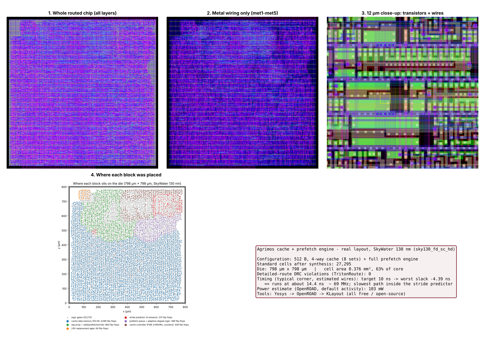

# Physical design: real chip layout (SkyWater 130 nm)

This folder takes the **same Verilog RTL** all the way to a real chip layout
(GDS) using only free, open-source tools:

```
RTL (rtl/*.v) --Yosys--> sky130 gate netlist --OpenROAD--> placed + routed layout --KLayout--> GDS + pictures
```



## What was done
| Step | Tool | Result |
|---|---|---|
| Synthesis to real cells | Yosys 0.33 + sky130_fd_sc_hd (typical, 25 °C, 1.8 V) | 27,295 standard cells (6,103 flip-flops) |
| Floorplan + power grid | OpenROAD | 798 µm × 798 µm die, met1 rails + met4/met5 straps |
| Placement | OpenROAD (RePlAce + legaliser) | cell area 0.376 mm², 63 % of core |
| Clock tree | OpenROAD TritonCTS | 6,103 clock sinks |
| Routing | OpenROAD FastRoute + TritonRoute | **0 DRC violations** after detailed routing |
| GDS + pictures | KLayout (Python module) | `out/chip.gds.gz`, `out/chip_*.png` |

## Results (from `out/final_reports.txt`)
* Timing: target clock 10 ns (100 MHz) **not met** – worst slack −4.39 ns,
  so this layout runs at about 14.4 ns ≈ **69 MHz** (typical corner, wire RC estimated from global routing,
  not a full parasitic extraction). The slowest path is inside the stride predictor
  (`u_pred.tr_addr` → stride compare → `trig_step`); pipelining that compare would be the next step.
* Power: about 103 mW (OpenROAD estimate with default switching activity).
* 127 small max-slew warnings (1.52 ns vs a 1.50 ns limit) and 1 max-capacitance warning remain.

## Important: 512 B version
A 4 KB cache built from flip-flops (≈ 39,000 flip-flops) is too large for a
reasonable run of this free flow – a real chip would use an SRAM macro for the
data array. So the layout uses **the same RTL with one parameter changed**
(`SETS = 8` → 8 sets × 4 ways × 16 B = 512 B, see `layout_top.v`).
That version was simulated on all 9 traces with the normal testbench
(`tb_layout_cfg.v`) and **all self-checks pass**; results in `sim_512B_results.txt`
(e.g. CNN 2.78×, LLM 2.13×, recsys 2.05× faster than the same cache without prefetching).
All headline numbers elsewhere in the project are for the 4 KB design.

## Files
| File | What it is |
|---|---|
| `layout_top.v` | layout wrapper (cache + prefetch engine, 512 B cache) |
| `synth_sky130.tcl`, `layout_top.sdc` | Yosys script, clock constraint |
| `flow.tcl` | OpenROAD floorplan → power → place → CTS → route → reports |
| `render_layout.py` | DEF + cell GDS → `chip.gds` and pictures (KLayout) |
| `block_map.py` | colours each flip-flop by the RTL block it belongs to |
| `make_overview.py` | the summary figure above |
| `out/chip.gds.gz` | the final layout (gunzip, then open in KLayout) |
| `out/final_reports.txt`, `out/openroad.log`, `out/synth_stat.txt` | reports and logs |

## Re-run it
Tools: `yosys`, `openroad`, `pip install klayout`, and the sky130A PDK
(here taken from the `litex-hub` conda channel: packages `openroad` and `open_pdks.sky130a`).
```bash
export PDK_ROOT_SKY130=/path/to/share/pdk/sky130A
export OPENROAD=/path/to/openroad
bash run_layout.sh          # about 45 minutes on 2 CPU cores
klayout out/chip.gds        # look at the chip
```
